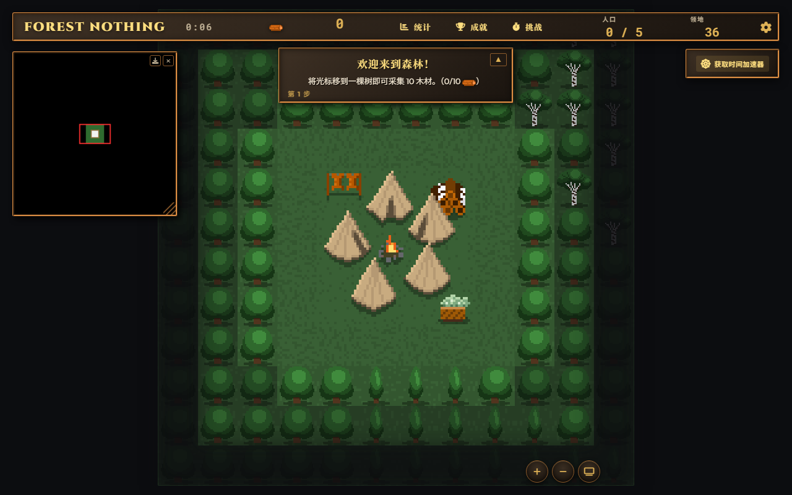
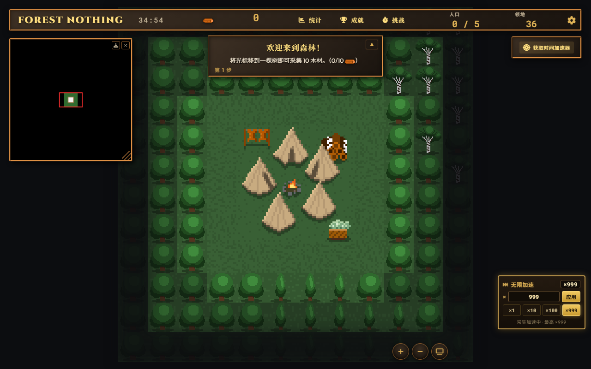

# Forest Nothing（简体中文汉化版）

中世纪像素风放置/经营网页游戏：带着村民把整片森林砍光，砍倒的树变成你的领地；再用木材、食物、布料、石头和金币盖房、修路、点技能树、收集遗物，最后领取「传承」带着永久加成重开一局。

本目录是原版 <https://forestnothing.jcbdev.com/play/> 的**完整离线副本 + 简体中文汉化**。



## 运行

无需安装，三种方式任选：

1. **直接双击 `index.html`**（现代 Chrome / Edge 均可）。
2. **双击 `启动服务器.bat`**：自动找 Python、绑定所有网卡，并在窗口里打印「本机」和「局域网」两个地址；手机、同 Wi-Fi 的其他电脑用局域网那个地址就能玩。
3. 手动起一个静态服务器：

   ```bash
   python -m http.server 8765 --bind 0.0.0.0
   ```

   然后浏览器打开 <http://127.0.0.1:8765/>。

存档写在浏览器 `localStorage` 里；想从头开始，清掉该站点的站点数据即可。

### 局域网（手机 / 其它电脑）打不开时

原版这里踩的坑：`python -m http.server` 默认只监听 `127.0.0.1`（仅本机回环），所以别的设备连不上。要监听所有网卡：

```bash
python -m http.server 8765 --bind 0.0.0.0
```

然后用本机的局域网 IP 访问，例如 <http://192.168.0.120:8765/>（用 `ipconfig` 查 `IPv4 地址`）。排查顺序：

1. **地址对不对**：必须是主机的 `192.168.x.x / 10.x.x.x` 地址，不是 `127.0.0.1`。
2. **防火墙**：Windows 首次监听会弹窗，选「允许访问」。本机已为 `python.exe` 建了入站允许规则；若换用别的 Python，需要在「Windows 安全中心 → 防火墙 → 允许应用通过防火墙」里放行。
3. **网络位置**：当前 Wi-Fi 被识别为「公用网络」时限制更多，保持那条入站规则为「允许」即可；也可把网络改成「专用」。
4. **同一网段、非访客网络**：手机连的是不是同一个路由器？访客 Wi-Fi 常带「AP 隔离」，设备之间互相不可见，需要关掉或换主网络。
5. **浏览器强制 HTTPS**：地址栏手动输入 `http://` 前缀，别让它自动跳 `https://`。
6. **IP 变了**：DHCP 重新分配的地址会变，重新 `ipconfig` 查，或在路由器里给这台机器绑定固定 IP。
7. **端口被占**：换端口，如 `set PORT=8800` 后再运行 bat，或 `python -m http.server 8800 --bind 0.0.0.0`。

> 注意：`--bind 0.0.0.0` 会把游戏共享给整个局域网，公共 Wi-Fi 下不建议这样做。

## 汉化内容

- **全部 2760 条文案**：主菜单、HUD、建造面板、教程、村民职业、技能树、成就、挑战、商店、装饰品、天气、更新日志、提示气泡、存档/报错弹窗等。
- **代码内提示**：`_lx()` 内联提示（存档冲突、存储已满、CrazyGames 云存档提示等）共 54 条 + 2 条动态规则也已翻译。
- **操作方式词条**：电脑/手机两套「右键点击 / 长按」「滚轮 / 双指捏合」等按设备切换的词条。
- **默认语言为简体中文**：首次进入即中文；右上角地球图标或「选项 → 语言」可切回其他 10 种语言，选择会记住。
- **数字本地化**：千分位用 `,`、小数点用 `.`（如 `1,000`、`×2.5`），日期用 `2026年11月11日` 格式。

## 已验证

用无头 Chrome 实际运行检查过：加载无 JS 报错（仅 favicon 之外无 404），主界面、成就、统计、技能树、如何游玩、商店、选项、更新日志、挑战、人口面板均正常显示中文，控制台无异常；语言切换（中文 ↔ 英文）往返正常。

无限加速压测：`×999` 连跑 8 秒真实时间，游戏内推进 8008 秒（实测 ×1000），25 名村民照常伐木、木材正常入账、无 NaN、无报错、帧率 41–50 FPS；输入 `5000 / 0 / -7 / 12.6` 分别夹到 `999 / 1 / 1 / 13`；刷新后倍率与输入框都能恢复。

## 无限加速（新增功能）

原版的「时间加速器」绑在离线时间银行上：要有攒下的时间才能开、开着会倒计时烧完，广告加速还有 10 分钟冷却。这里把倍率功能单独提成常驻开关：

- 左下角「⏩ 无限加速」面板：直接在输入框填 **1–999** 之间的任意倍率，点「应用」或按回车生效；也有 `×1 / ×10 / ×100 / ×999` 快捷档。
- **不消耗任何时间**、**没有冷却**、**没有时长上限**，选了就一直生效。
- 输入越界会自动夹回：`5000 → 999`、`0 / 负数 → 1`，小数四舍五入。
- 选择记在 `localStorage`（`fn_free_speed`），刷新/重开浏览器后仍然是上次的倍率；首次打开默认 `×2`。
- 游戏时钟、资源产出、村民移动、天气与云的速度都按同一倍率走。
- 与原版的银行加速互斥（避免叠乘）：在游戏里手动开银行加速会自动退回 `×1`。
- 挑战模式（Reto）内刻意不生效，和原版对加速器的公平性限制一致。



## 与原版的差异

| 文件 | 改动 |
| --- | --- |
| `lang.js` | 新增 `zh` 语言块（2760 条，按 `es` 原文逐条对应）；`LANG_NAMES`、日期区域加上 `zh`；`_DEVICE_TOKENS` 增加中文两套词；新增 `_LX_ZH` 内联提示表并让 `_lxL()` 支持 `zh` |
| `main.js` | 汉化：`_browserLangCode()` 识别 `zh`；无存档时默认 `setLang('zh')`；数字格式（千分位/小数/百分比）对 `zh` 按中文习惯；`_fmtRate` 改用当前语言的区域设置。新功能：`_freeSpeedMult` + `setFreeSpeed()`，在游戏循环里按倍率乘 `_dt`、`_ambientBoost()` 同步天气速度 |
| `speed.js` | **新增**：无限加速面板（倍率按钮、记忆选择、与游戏内状态联动） |
| `index.html` | 语言下拉框增加「中文（简体）」并默认选中；启动画面「正在加载…」；初始静态标签（城镇中心、搬运工、骡子等）改为中文；`<html lang="zh-CN">`；补了 favicon；引入 `speed.js` |
| `index.css` | 末尾追加中文专用样式（技能树节点名标签固定宽度）与无限加速面板样式 |

品牌名 **FOREST NOTHING** 按惯例保留原文。

## 说明

- 游戏本体（美术、音频、代码）版权归原作者 JC 所有，本目录仅作个人汉化学习/游玩使用。
- 页面仍会请求 Google Fonts（Cinzel / Outfit / Roboto Mono）和 Font Awesome CDN；断网时会退回系统字体，功能不受影响。
- 原版的 CrazyGames 广告 SDK 与统计脚本在此构建里本就是关闭/本地不启用状态（`FN_GAME_MODE = 'sinads'`），汉化版没有额外改动它们。

## 文件

```text
index.html          页面结构（已汉化静态文案、语言选项）
index.css           样式（含中文技能名标签修正、无限加速面板）
lang.js             10+1 种语言文案（新增 zh 块）
main.js             游戏逻辑（数字/语言适配、无限加速倍率）
speed.js            无限加速面板（新增）
启动服务器.bat      一键启动本地服务器并打印局域网地址（新增）
assets_list.js      资源清单
worlds/world1.js    世界 1「森林」数据
worlds/world2.js    世界 2「河谷」数据
assets/             532 个精灵图与贴图
preview.png         游戏预览
preview-howto.png   「如何游玩」面板预览
preview-speed.png   无限加速面板预览
```
